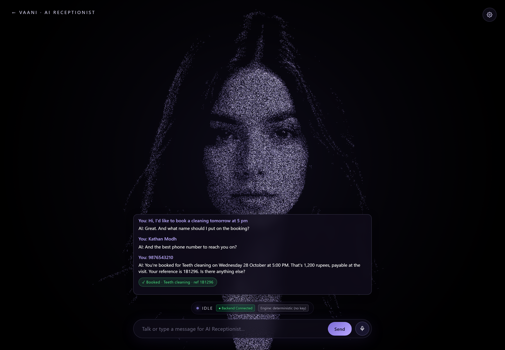
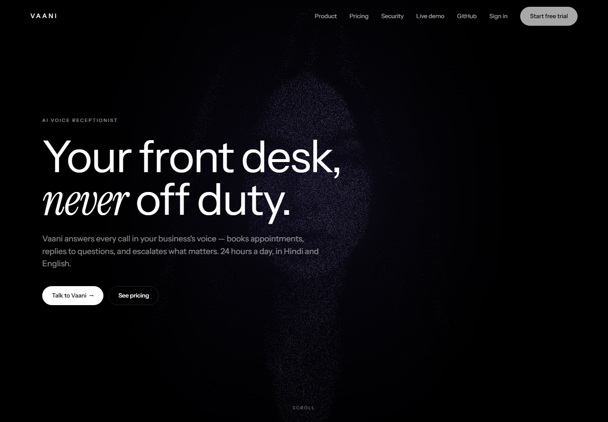
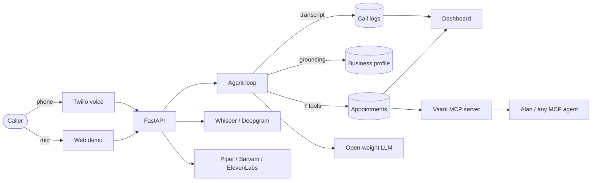

# Vaani

[](https://github.com/KathanModh259/vaani/actions/workflows/ci.yml)
[](LICENSE)

**An open-source phone receptionist that answers in Hindi, Gujarati and English — and actually books the appointment.**

Built for [OpenFire](https://tryalan.ai) with Alan and open-weight models. No closed LLM required, no per-minute vendor lock-in, and every confirmation a caller hears exists as a row in a database.

```bash
git clone https://github.com/KathanModh259/vaani && cd vaani/backend
python -m venv .venv && .venv/Scripts/pip install -r requirements-dev.txt   # Linux/macOS: .venv/bin/pip
.venv/Scripts/python -m uvicorn app:app --port 8000
# open http://localhost:8000/app
```

That runs with **zero API keys**. The deterministic booking flow books real appointments on a real calendar. Add one open-model key to turn on multilingual conversation, and the rest of the product does not change.

---

## What it looks like

A caller books from the browser — no model key configured, so the deterministic
flow answers and writes the appointment. The reference in the chip is the
committed row:



The landing page, if you want the front door rather than the reception desk:



---

## The problem

A clinic in Ahmedabad misses calls after 6pm. The caller speaks Gujarati, switches to English for "appointment", and hangs up when they reach a menu. The owner loses the booking and never knows it happened.

Vaani is the front desk for that clinic: it answers, understands the language mix, checks a real calendar, books the slot, texts a confirmation, and files the transcript. If it cannot help, it takes a message or transfers the call instead of inventing an answer.

## What is actually real

This matters more than a feature list, so here is the honest boundary.

| Capability | Status |
|---|---|
| Multilingual conversation (Hindi / Gujarati / English / code-switched) | Real, via an open-weight model |
| Booking with **no model at all** | Real: deterministic slot filling over the same tools |
| Appointment availability and booking | Real rows in `appointments`, conflict-checked, read back after commit |
| Double-booking protection | Real: serialised check-then-insert under a row lock; the loser gets alternatives |
| Call transcripts, dashboard analytics | Real, computed from `call_logs` |
| FAQ answers | Grounded in the owner's own profile and service catalog, never model memory |
| Escalation, message taking, owner alerts | Real flags, stored messages, one alert per call |
| Twilio inbound calls | Webhook implemented and signature-verified: `<Gather>` mode and ConversationRelay mode |
| SMS / WhatsApp confirmations and reminders | Real, via Twilio; needs a sender and (in India) a DLT-registered service |
| Google Calendar two-way busy sync | Real: OAuth, busy lookups, event mirroring |
| Multi-tenant: signup, login, API keys, per-business data | Real, with row-scoped access |
| Self-serve phone numbers | Implemented, **off by default** — buying numbers spends real money |
| Billing | Plan records only. No payment capture |
| Human-sounding TTS in Gujarati | **Not yet.** Piper has no Gujarati voice; STT and text replies work |
| Streaming barge-in | ConversationRelay supports it; the `<Gather>` path is turn-based |

## Why the booking is trustworthy

Four mechanisms, all testable:

1. **The model cannot answer from memory.** It gets seven tools and a prompt that forbids stating a price, a policy or availability that a tool did not return.
2. **A claim without a tool is caught.** If the model says "you're booked" and `book_appointment` never returned `booked=true`, the loop sends one correction round before the caller hears anything (`llm_agent/llm_provider.py`).
3. **The write is the only source of truth.** Confirmation text is generated from the committed row, never from the model's prose.
4. **The fallback is deterministic, not a lie.** With no model, `llm_agent/booking_flow.py` asks for service, day, time, name and number, then calls the same tools. It also refuses: a caller asking for a slot that is gone gets the free alternatives.

```bash
# same slot, twice
curl -s -X POST localhost:8000/api/chat -H 'Content-Type: application/json' \
  -d '{"message":"teeth cleaning tomorrow at 11 am, name Meera, 9988776655"}'
```

```json
{
  "response": "You're booked for Teeth cleaning on Tuesday 27 October at 11:00 AM. That's 1,200 rupees, payable at the visit. Your reference is DD3E02. Is there anything else?",
  "source": "rules",
  "booked": [{ "appointment_id": "…", "service": "Teeth cleaning", "starts_at": "2026-10-27T11:00:00+05:30", "reference": "DD3E02" }]
}
```

Then check the database yourself:

```bash
sqlite3 backend/phone_receptionist.db \
  "select customer_name, start_time, status from appointments;"
```

Ask for the same slot twice and the second caller gets `taken` plus the free times. That path is covered by a concurrency test, not just a unit test.

## Open models, by default

Vaani speaks the OpenAI-compatible chat API, which is what every serious open-weight host exposes. `LLM_PROVIDER=auto` picks the first configured provider:

| Provider | Key | Default model | Notes |
|---|---|---|---|
| OpenRouter | `OPENROUTER_API_KEY` | `qwen/qwen3-30b-a3b-instruct-2507` | One key, most open weights. Append `:free` for the free tier |
| Groq | `GROQ_API_KEY` | `llama-3.3-70b-versatile` | Highest token throughput; good for voice |
| Together | `TOGETHER_API_KEY` | `Qwen/Qwen2.5-72B-Instruct-Turbo` | |
| Ollama | none | `qwen2.5:7b-instruct` | Fully local, no data leaves the machine |
| Any vLLM / LM Studio / Azure | `LLM_BASE_URL` | whatever you serve | Set `LLM_MODEL` |
| OpenAI | `OPENAI_API_KEY` | `gpt-4o-mini` | Supported, reported as `open_weights: false` |

```ini
# .env — pick one
LLM_PROVIDER=openrouter
OPENROUTER_API_KEY=sk-or-...
LLM_MODEL=qwen/qwen3-30b-a3b-instruct-2507
```

`GET /api/llm/status` reports the live provider, model, whether the weights are open, and which providers are queued as failovers. It is a configuration read — no network call, so the dashboard can poll it.

**Failover is free.** Configure two providers and a rate limit on the first is a two-second hiccup, not a dead call: `llm_provider` walks the chain before giving up and degrading to the deterministic flow.

## Use Vaani from Alan

Vaani is a phone and a calendar for an Alan agent. The surface is an MCP server
over stdio, dependency-free, with **tools and prompts** — the prompts are how an
agent learns the safe procedure instead of inferring it from tool descriptions.

```bash
python mcp/vaani_mcp.py --check     # protocol + a real booking on a throwaway DB
python mcp/vaani_mcp.py --print     # the mcpServers snippet, absolute paths
python mcp/vaani_mcp.py --install --client claude    # or cursor, claude-desktop
```

`--check` prints `READY` only after it has booked an appointment and confirmed
the slot disappeared from availability. It never touches your database.

```json
{
  "mcpServers": {
    "vaani": {
      "command": "python",
      "args": ["mcp/vaani_mcp.py"],
      "env": { "VAANI_DATABASE_URL": "sqlite+aiosqlite:///phone_receptionist.db" }
    }
  }
}
```

**Nine tools:** `vaani_check_availability`, `vaani_book_appointment`,
`vaani_upcoming_appointments`, `vaani_reschedule_appointment`,
`vaani_cancel_appointment`, `vaani_daily_digest`, `vaani_list_calls`,
`vaani_get_transcript`, `vaani_business_info`.

**Two prompts:** `book-appointment` (the only safe order to book in) and
`clear-the-day` (move every appointment off a date when a doctor is out —
reschedule books the new slot before cancelling the old one, so a failed move
never strands a patient).

An agent can do things a receptionist cannot: empty a day, work the
`needs_attention` callback queue from the digest, or stand up a front desk for
a second tenant. [docs/ALAN.md](docs/ALAN.md) covers those workflows, the
safety model for unsupervised agents, and what is deliberately *not* exposed
(no raw SQL, no bulk delete, no billing writes).

`skills/vaani-receptionist/SKILL.md` is the Alan skill: which tool to call, how
to read a refusal, and how to report a booking to a non-technical owner.

## Architecture



```
backend/
  api/routes/     chat, voice (Twilio), relay, speech, dashboard, auth, business, numbers, account, integrations
  llm_agent/      provider layer, tool loop, deterministic booking flow, tools
  services/       booking engine, profiles, call logging, escalation, alerts, gcal, reminders, retention, usage
  stt/ tts/       faster-whisper, Deepgram, Piper, Sarvam, ElevenLabs
  evals/          scripted calls against a real model
  tests/          booking, concurrency, security, voice, MCP, provider, flow
frontend/         landing, particle-avatar voice demo, dashboard, legal
mcp/              MCP server for Alan and other agents (tools + prompts)
skills/           Alan skill for operating Vaani
deploy/           Caddyfile (TLS) and the compose env template
docs/             Alan guide, demo script, submission checklist, generated evidence
```

## Prove it in one command

```bash
cd backend && python -m scripts.demo_run
```

It runs the real app and the real MCP server on a throwaway database and walks
the whole story: a caller books, a second caller is refused, an FAQ is answered
from the owner's profile, an escalation is recorded, an agent moves the
appointment through MCP, and the owner reads the transcript. Every line is an
assertion; the exit code is non-zero if any step fails.

[`docs/EVIDENCE.md`](docs/EVIDENCE.md) is the generated transcript of that run -
30 checks, 0 failures, no model key configured. Regenerate it rather than
trusting it:

```bash
python -m scripts.demo_run --write-evidence docs/EVIDENCE.md
```

For a live demo, `python -m scripts.demo_reset --yes` clears bookings and call
logs first so the first booking on camera is genuinely the first.

## Measured, not claimed

```bash
cd backend && python -m evals.run          # needs one model key
```

The evals are callers, not unit tests: English and Hindi and code-switched bookings, relative dates ("day after tomorrow"), closed days, double booking, prompt injection, and cancellation. Each checks what landed in the database and prints the provider and `open_weights` at the end, so a failed run cannot be misread as a pass.

The container and the compose stack are verified the same way: CI builds the
image, runs it, waits for `/health/ready`, loads the landing page and the demo,
and books an appointment through the running container. A second CI job brings
the full stack up behind Caddy and runs `scripts/preflight` against it.

Building alone is not enough. An image once died on `import sqlalchemy` because
its wheelhouse was built `--no-deps`, and another died without `alembic` in
`requirements.txt`; both were found by running the image, not by building it.

### Latency, on this machine

`python -m scripts.bench` drives the real endpoints in-process against SQLite on
a 16-core Windows box. It measures the parts Vaani controls, not the network:

| Path | n | p50 | p95 | max |
|---|---|---|---|---|
| Chat turn (deterministic rules) | 200 | 15.6 ms | 18.2 ms | 120.7 ms |
| Booking write, end to end | 20 | 22.6 ms | 27.8 ms | 31.8 ms |
| Availability read | 50 | 0.7 ms | 0.9 ms | 1.6 ms |

Speech recognition, the model provider and speech synthesis are excluded: those
are network-bound and vary by provider, so quoting them here would flatter the
numbers rather than describe the product.

`pytest` runs 235 tests (1 skipped on SQLite, 236 on Postgres) — both databases are in CI. The suite covers the concurrency race, prompt-injection refusals, encrypted transcripts, CSRF on the cookie session, Twilio signature checks, the MCP server and the zero-key booking dialogue.

## Deploy

**Render, one click.** `render.yaml` creates the web service, a managed
Postgres, and generated secrets. Set `OPENROUTER_API_KEY` when prompted.

**Any VPS, one command.** The compose stack ships the API, Postgres, Redis,
Caddy (automatic TLS) and nightly backups:

```bash
cp deploy/compose.env.example .env
cd backend && python -m scripts.init_env --write && cd ..
# edit .env: PUBLIC_BASE_URL=https://your.domain DOMAIN=your.domain
docker compose up -d --build
```

`init_env` generates the JWT secret, the transcript encryption key and the
database password, and keeps `.env` and `backend/.env` in sync — compose's
`environment:` block wins over `env_file`, so a mismatch would silently deploy
different secrets than the app file says. It never replaces an existing
encryption key or database password: replacing either destroys data.

Then prove the deployment from outside:

```bash
cd backend && python -m scripts.preflight https://your.domain
```

TLS and the certificate, the proxy's security headers, health and readiness,
which model answers and whether its weights are open, whether Twilio is
configured, all three pages, and a booking that really commits — proven by
watching the same slot get refused. `--no-book` skips the booking.

Only Caddy is published to the internet; the API, Postgres and Redis never are.
The app refuses to boot in production with a placeholder secret, no
`ENCRYPTION_KEY`, `DEBUG=true`, or SQLite. `DEPLOYMENT.md` has the full guide,
the configuration table, the restore procedure and the checklist.

## What I would build next

1. **Gujarati TTS.** STT and replies already work; Piper has no Gujarati voice, so the last mile is missing. Fine-tuning a VITS voice is the obvious next step.
2. **Streaming turns.** The `<Gather>` path is transcribe → model → synthesise. ConversationRelay already streams; finishing barge-in on both paths is the latency win.
3. **Alan task per escalation.** File an Alan task with the transcript when a caller asks for a human, so the team works the callback in the same place as the rest of its queue.
4. **Payment capture.** Plans exist; Stripe does not. Until it does, self-serve numbers stay off.

## License

MIT. See [LICENSE](LICENSE). Security policy and what an operator must protect:
[SECURITY.md](SECURITY.md).